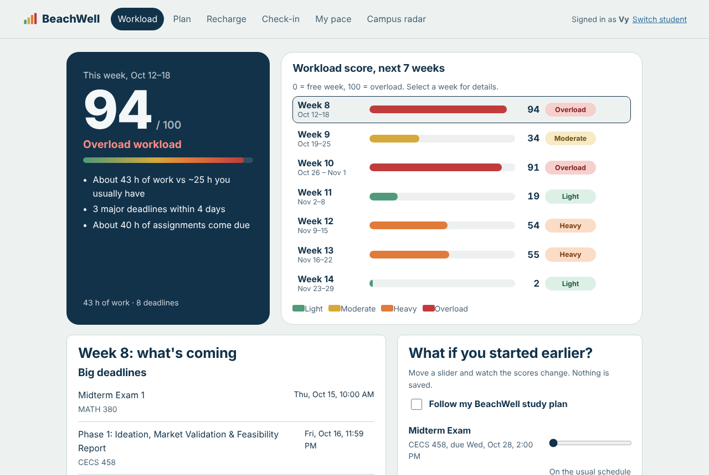
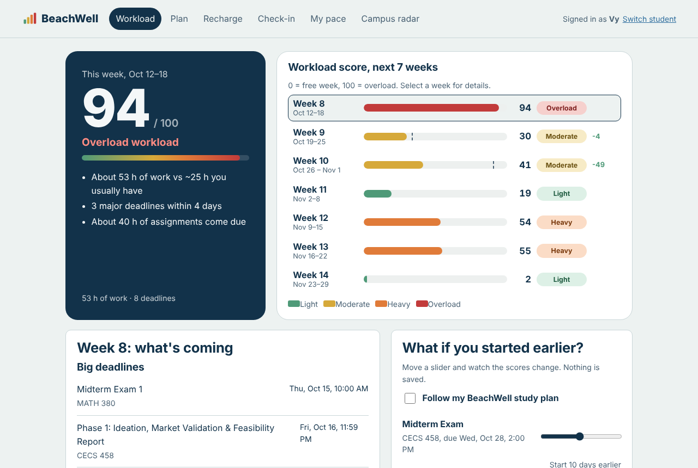
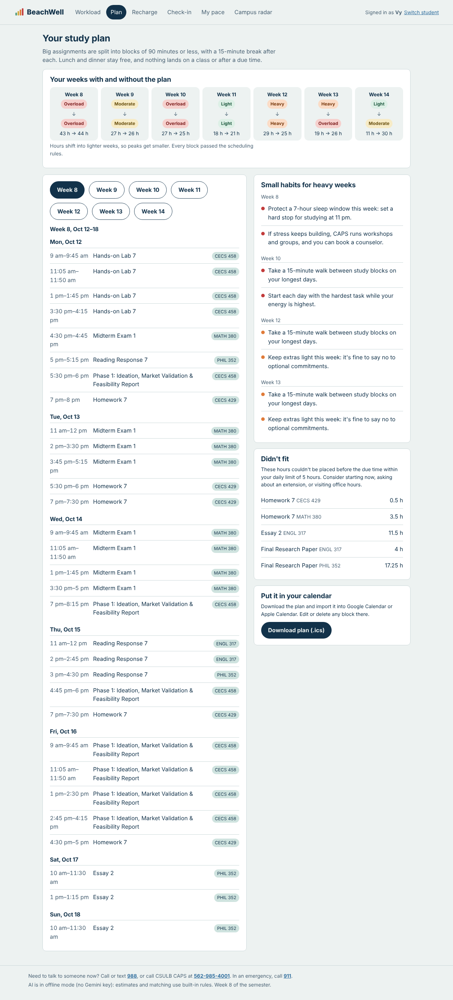
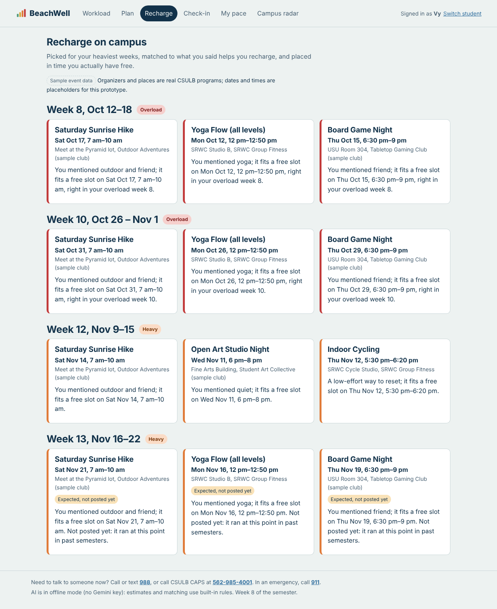
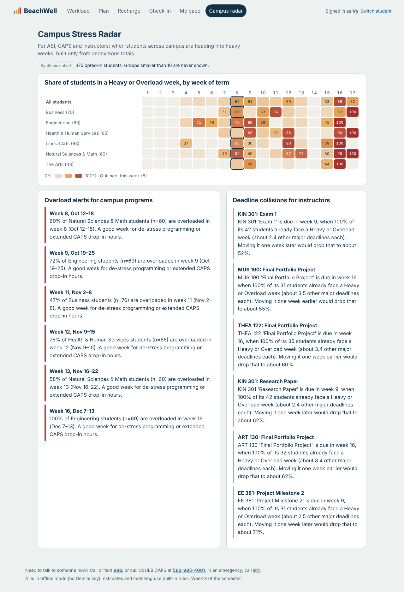
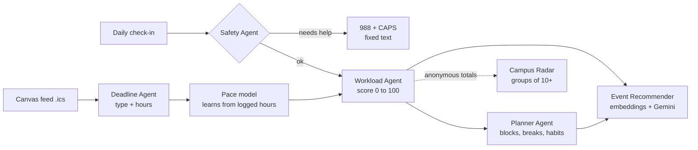

# BeachWell

**A weekly workload score for CSULB students.** BeachWell reads a student's Canvas deadlines and short daily check-ins, gives every week of the semester a Workload Score from 0 to 100 (Light, Moderate, Heavy or Overload), builds a study plan that spreads the work into lighter weeks, suggests small habits for heavy weeks, and recommends campus events that fit the student's free time. A Campus Stress Radar shows ASI, CAPS and instructors, anonymously, when whole groups of students are heading into an overload week.

CECS 458/558 term project, Fall 2026. Team: Vo Hong Vy Le and Deborah Shaw.

> BeachWell plans and recommends. It never diagnoses or gives medical advice, and any sign of crisis sends the student straight to the 988 Lifeline and CSULB CAPS.



## What it does

| Screen | What the student sees | AI behind it |
| --- | --- | --- |
| Workload | This week's score (0–100) and level, with reasons, plus a 7-week bar chart | Deadline Agent (effort estimates), Workload Agent (scoring) |
| What-if slider | Start an assignment earlier, or "follow my plan," and watch the scores change | Workload Agent re-run with new inputs |
| Plan | Study blocks of 90 minutes or less, with breaks; before/after workload levels; habit tips; .ics export | Planner Agent (scheduler + habits) |
| Recharge | 2–3 de-stress events per heavy week that fit the student's free time and interests | Event Recommender (embeddings, rules, Gemini re-ranking) |
| Check-in | Sleep and stress in 20 seconds; the note is safety-checked then discarded | Safety Agent |
| My pace | "You take 30% longer than estimated on essays"; log hours, fix estimates | Personal pace model (learns from logged hours) |
| Campus Radar | Heatmap by college and week, overload alerts, deadline collisions with a what-if | Radar Agent (anonymous aggregation, groups of 10+ only) |

## Quick start (about 5 minutes)

Requirements: Python 3.10 or newer. No database server and no Node.js are needed.

```bash
cd backend
python -m venv .venv
# Windows: .venv\Scripts\activate      macOS/Linux: source .venv/bin/activate
pip install -r requirements.txt
cp .env.example .env              # Windows: copy .env.example .env
python scripts/seed.py --reset    # sample events, a synthetic cohort, and the demo student "Vy"
uvicorn beachwell.app:app --reload --port 8000
```

Open **http://localhost:8000** and click **Open the demo**. The API list is at http://localhost:8000/api.

### Turn on Gemini

The app runs without an API key ("offline mode": rules and hashed embeddings), so anyone can reproduce the results. To use Gemini, put a key from [Google AI Studio](https://aistudio.google.com) in `backend/.env`:

```
GEMINI_API_KEY=your-key
LLM_MODEL=gemini-2.5-flash
EMBEDDING_MODEL=gemini-embedding-001
```

Restart the server. The footer of the app shows which mode is active. To estimate the demo student's deadlines with Gemini too, reseed with `python scripts/seed.py --reset --llm`. Check [Google's model list](https://ai.google.dev/gemini-api/docs/models) if a model name has been retired.

### Use your own Canvas deadlines

In Canvas, open **Calendar**, then **Calendar Feed**, and copy the link. Paste it on the BeachWell welcome screen, or download the `.ics` file and upload it. The link is used once to import deadlines and is never stored. Only `https://…instructure.com` links are accepted.

### Reproduce a sample result

```bash
cd backend
python -m unittest -v           # 32 tests, offline
python eval/evaluate.py         # writes eval/results.md and eval/results.json
```

## Evaluation (offline mode, from `backend/eval/results.md`)

| Component | Baseline | BeachWell |
| --- | --- | --- |
| Effort estimates, mean abs. error (60 labeled items) | 2.58 h (type keyword only) | **1.75 h** |
| Finding crunch weeks, F1 (40 synthetic semesters) | 0.67 (deadline count) | **1.00** |
| Pace learning, error in weeks 9–17 (40 simulated students) | 1.41 h (no pace) | **0.77 h** |
| Planner, average peak week (20 synthetic students) | 41.5 h | **30.1 h**, 0 rule violations |
| Planner, overload weeks per student | 3.15 | **1.6** |
| Event picks, Precision@3 (24 personas) | 0.47 (keyword overlap) | **0.50**, Hit@1 0.79 vs 0.63 |
| Safety screen, crisis recall (28 messages) | – | 1.00 with 0 false alarms* |

Labels are placeholders written for the prototype, and three of the six tests use synthetic data; see the notes in `eval/results.md`. \*The safety rules were improved after a first run on this set, so the team should re-test on a fresh set. Run with a Gemini key to add the Gemini rows.

## Screenshots

| | |
| --- | --- |
|  |  |
|  |  |

## Architecture



* **Backend:** Python, [Starlette](https://www.starlette.io) (the framework FastAPI is built on) served by Uvicorn, SQLite from the standard library. Each agent is a plain module in `backend/beachwell/agents/` with its own tests.
* **AI:** Google Gemini over its REST API (`beachwell/llm.py`), with deterministic offline fallbacks. How each prompt is used, and what the team built beyond the API, is documented in [docs/AI_WORKFLOW.md](docs/AI_WORKFLOW.md).
* **Frontend:** one static page in `frontend/` (HTML, CSS and JavaScript modules, no build step), served by the backend.

## Project layout

```
backend/
  beachwell/
    app.py            HTTP API and static file serving
    service.py        glue between storage and agents
    config.py         settings from environment variables / .env
    db.py             SQLite schema (feed links never stored; check-in notes discarded)
    ical.py           read Canvas .ics feeds, write .ics study plans
    llm.py            Gemini REST client, call log, offline fallbacks
    semester.py       week-of-term helpers
    seed.py           loads the event catalog; builds the synthetic cohort and demo student
    agents/
      deadline.py     Deadline Agent: type and hour estimates
      pace.py         personal pace model (empirical Bayes)
      forecast.py     Workload Agent: weekly load index and reasons
      planner.py      Planner Agent: scheduler, rule checker, habits
      events.py       Event Recommender: retrieval, time fit, re-ranking
      safety.py       Safety Agent: rules + Gemini, fixed crisis response
      radar.py        Campus Radar: anonymous heatmap, alerts, collisions
  data/               events_catalog.csv (editable) and sample Canvas feeds (.ics)
  scripts/
    seed.py                     create the database
    make_practice_semesters.py  regenerate the 40 practice semesters
    merge_labels.py             combine Vy's and Deborah's labels, measure agreement
    score_sus.py                score the classmate survey
  labeling/           blank labeling sheets for each team member, plus a how-to
  tests/              unit and integration tests (python -m unittest)
  eval/               evaluation data, script and results
usability/            classmate test script, survey questions, response sheet
frontend/             index.html, styles.css, app.js
docs/AI_WORKFLOW.md   prompts, inputs/outputs, limitations, team contribution
```

## Main API endpoints

| Method | Path | Purpose |
| --- | --- | --- |
| POST | `/api/users` | Create a student |
| POST | `/api/users/{id}/calendar` | Import a Canvas feed (`{url}` or `{ics}`) |
| PUT | `/api/users/{id}/classes` | Set weekly class times |
| GET, POST | `/api/users/{id}/forecast` | Workload scores; POST for what-if (`extra_lead`, `use_plan`) |
| GET | `/api/users/{id}/plan`, `/plan.ics` | Study plan, and as a calendar file |
| GET | `/api/users/{id}/events` | De-stress picks for heavy weeks |
| POST | `/api/users/{id}/checkins` | Check-in with safety screening |
| GET | `/api/users/{id}/pace` | Personal pace model |
| PATCH | `/api/users/{id}/tasks/{task_id}` | Log actual hours, fix an estimate, mark done |
| GET | `/api/radar` | Campus Stress Radar |
| GET | `/api/llm-log` | Recent Gemini calls (name, latency, success) |

## Data

The project needs no real student data. Every file below is either generated by our code, copied from public CSULB pages, or written by the team.

| File | What it is | Where it comes from |
| --- | --- | --- |
| `backend/data/events_catalog.csv` | 20 recurring campus programs (title, place, days, times, tags) | Public ASI, CAPS and recreation pages; clubs marked "sample" are invented. Edit freely, then run `python scripts/seed.py --reset` |
| `backend/data/sample_canvas_feed.ics` | A Canvas-style calendar feed for 5 courses (89 deadlines) | Generated; upload it on the welcome screen to test the import |
| `backend/data/sample_canvas_feed_business.ics` | A second feed with 4 business and GE courses | Generated |
| `backend/eval/data/practice_semesters.json` (+ `_deadlines.csv`) | 40 practice semesters, each with one known crunch week and one decoy week | Generated by `scripts/make_practice_semesters.py` |
| `backend/eval/data/effort_labels.csv` | 60 assignment titles with type and hours | Draft labels now; replaced by the team's averaged labels after `merge_labels.py` |
| `backend/eval/data/event_personas.json` | 24 sample students and their best-fitting events | Same as above |
| `backend/eval/data/safety_messages.csv` | 30 everyday-stress and 30 help-needed messages | Written for the prototype |
| `backend/labeling/` | Blank sheets for Vy and Deborah, the event list, and a fresh safety set to write | Team (see `labeling/README.md`, about 2 hours each) |
| `usability/` | Test script, SUS survey and response sheet for 8–10 classmates | Team (see `usability/test_script.md`) |

### Team workflow for the data (in order)

1. Each person fills in their own sheets in `backend/labeling/` without looking at the other's.
2. Together, write 60 new safety messages in `backend/labeling/safety_messages_team.csv`.
3. Run `python scripts/merge_labels.py` and then `python eval/evaluate.py`.
4. Run the classmate test, type answers into `usability/sus_responses.csv`, then run `python scripts/score_sus.py`.
5. Quote `labeling/agreement_report.md`, `eval/results.md` and `usability/sus_results.md` in the reports.

## Data, privacy and responsible AI

* All data in this prototype is **sample or synthetic**. Event organizers and venues are real CSULB programs, but every date and time is a placeholder.
* Canvas feed links are used once and never stored. Check-in notes are screened for safety and then discarded; only the two numbers are kept.
* Students can delete everything with one request (`DELETE /api/users/{id}`).
* The Campus Radar counts only students who opted in and never shows a group smaller than 10.
* The crisis response is fixed text written by people; the language model never writes it.
* Workload scores are estimates and are labeled that way. Effort estimates can always be corrected by the student.

## Known limitations

* Gemini support is implemented and tested with mocked responses, but the published numbers are offline-mode results. Run `python eval/evaluate.py` with a key to measure the Gemini versions.
* Evaluation labels are placeholders and should be re-labeled by two team members.
* The semester calendar (start date, Thanksgiving week) is a placeholder; set it in `.env`.
* SQLite suits a prototype. A campus deployment would move to PostgreSQL and add sign-in with CSULB SSO.
* The "expected events" projection assumes recurring programs keep the same week of term.

## Team contributions

| Member | Responsibility |
| --- | --- |
| Vo Hong Vy Le | Backend, AI agents and evaluation |
| Deborah Shaw | Web app, market research, event catalog and reports |
| Both | Independent labeling of the test data |

License: MIT.
