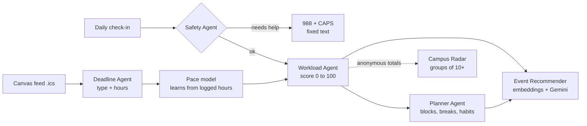

# BeachWell

**A weekly workload score for CSULB students.** BeachWell reads a student's Canvas deadlines and short daily check-ins, gives every week of the semester a Workload Score from 0 to 100 (Light, Moderate, Heavy or Overload), builds a study plan that spreads the work into lighter weeks, suggests small habits for heavy weeks, and recommends campus events that fit the student's free time. A Campus Stress Radar shows ASI, CAPS and instructors, anonymously, when whole groups of students are heading into an overload week.

CECS 458/558 term project, Fall 2026. Team: Vo Hong Vy Le and Deborah Shaw.

## What to do next (updated Oct 28, 2026)

Phase 1 is done: the working prototype (all 7 parts, 32 tests), first evaluation results and the Phase 1 report. The list below is what is left, in order of due date. Owners are a proposal; change them as we agree.

### By Fri Oct 23: data
- [ ] **Real event dates** (Deborah): replace the placeholder dates and times in `backend/data/events_catalog.csv` with real ASI, CAPS and Rec programs, add a few new ones, then run `python scripts/seed.py --reset`.
- [x] **Deborah's labels** (done Oct 27): `effort_labels_deborah.csv`, `persona_labels_deborah.csv`, and 30 safety messages in `safety_messages_team.csv`. They are already used: see "Learning from the team's labels" below.
- [ ] **Vy's labels** (Vy): fill in `effort_labels_vy.csv` and `persona_labels_vy.csv` without looking at Deborah's (about 2 hours). Then we get agreement (Cohen's kappa) and averaged labels.
- [ ] **Vy's unseen safety set** (Vy): 15 everyday-stress and 15 help-needed messages in `backend/labeling/safety_messages_unseen.csv`, written without looking at `agents/safety.py` or Deborah's set. Deborah's set was used to fix the rules, so this is now the honest test.
- [ ] **Re-learn and re-test** (Vy): `python scripts/merge_labels.py`, then `python scripts/learn_from_labels.py`, then `python eval/evaluate.py`.

### By Fri Oct 30: run with Gemini
- [ ] **Get a Gemini API key** from Google AI Studio and put it in `backend/.env` only. Never commit it.
- [ ] **Re-run the evaluation** (Vy): `python eval/evaluate.py`, so the Gemini rows sit next to the offline and baseline rows.
- [ ] **Review Gemini's mistakes** (Vy): check `GET /api/llm-log` and note latency, failures, and the hour estimates it got most wrong.

### By Fri Nov 13: finished app on GitHub
- [ ] **GitHub repo** (both): each person commits their own part (Vy: backend, AI agents, evaluation; Deborah: web app, event list, docs). Check that no key or personal data is in the repo.
- [ ] **Test with a real Canvas feed** (both): import your own `.ics` locally to make sure the reader works. Do not upload it anywhere.
- [ ] **Web app polish** (Deborah): phone layout, wording on every screen, page background (white now; `#F6F8F8` is the other option).

### By Fri Nov 20: Phase 2
- [ ] **2-page progress report** (Deborah writes, Vy adds the numbers): what was built, evaluation with the team's labels and Gemini, and what changed since Phase 1.
- [ ] **GitHub documentation**: this README, `docs/AI_WORKFLOW.md` (prompts, inputs and outputs, limits), and how to reproduce the results.

### By Fri Dec 4: classmate test and error review
- [ ] **Usability test** (Deborah leads): 8–10 classmates, following `usability/test_script.md`. Enter answers in `usability/sus_responses.csv`, then run `python scripts/score_sus.py`.
- [ ] **Error review** (Vy): look at the worst cases (wrong hour estimates, poor event picks) and write them up for the final report.

### By Fri Dec 11: Phase 3
- [ ] **10-minute pitch video** (both; each presents their own part). Best demo moment: drag the what-if slider and watch an overload week's score drop. No keys or real student data on screen.
- [ ] **Final report** (both).

Both of us should be able to explain the whole system, since questions can go to either person.

BeachWell is a learning project that helps CSULB students plan their workload. It does not provide medical advice


## What it does

| Screen | What the student sees | AI behind it |
| --- | --- | --- |
| Workload | This week's score (0–100) and level, with reasons, plus a 7-week bar chart | Deadline Agent (effort estimates), Workload Agent (scoring) |
| What-if slider | Start an assignment earlier, or "follow my plan," and watch the scores change | Workload Agent re-run with new inputs |
| Plan | Study blocks of 90 minutes or less, with breaks; before/after workload levels; habit tips; .ics export | Planner Agent (scheduler + habits) |
| Recharge | 2–3 de-stress events per heavy week that fit the student's free time and interests | Event Recommender (embeddings, rules, Gemini re-ranking) |
| Check-in | Sleep and stress in 20 seconds; the note is safety-checked then discarded | Safety Agent |
| My pace | "You take 30% longer than estimated on essays"; log hours, fix estimates | Personal pace model (learns from logged hours) |
| Campus Radar | Heatmap by college and week, overload alerts, deadline collisions with a what-if | Radar Agent (anonymous aggregation, groups of 10+ only) |

## Quick start (about 5 minutes)

Requirements: Python 3.10 or newer. No database server and no Node.js are needed.

```bash
cd backend
python -m venv .venv
# Windows: .venv\Scripts\activate      macOS/Linux: source .venv/bin/activate
pip install -r requirements.txt
cp .env.example .env              # Windows: copy .env.example .env
python scripts/seed.py --reset    # sample events, a synthetic cohort, and the demo student "Vy"
uvicorn beachwell.app:app --reload --port 8000
```

Open **http://localhost:8000** and click **Open the demo**. The API list is at http://localhost:8000/api.

### Turn on Gemini

The app runs without an API key ("offline mode": rules and hashed embeddings), so anyone can reproduce the results. To use Gemini, put a key from [Google AI Studio](https://aistudio.google.com) in `backend/.env`:

```
GEMINI_API_KEY=your-key
LLM_MODEL=gemini-2.5-flash
EMBEDDING_MODEL=gemini-embedding-001
```

Restart the server. The footer of the app shows which mode is active. To estimate the demo student's deadlines with Gemini too, reseed with `python scripts/seed.py --reset --llm`. Check [Google's model list](https://ai.google.dev/gemini-api/docs/models) if a model name has been retired.

### Use your own Canvas deadlines

In Canvas, open **Calendar**, then **Calendar Feed**, and copy the link. Paste it on the BeachWell welcome screen, or download the `.ics` file and upload it. The link is used once to import deadlines and is never stored. Only `https://…instructure.com` links are accepted.

### Reproduce a sample result

```bash
cd backend
python -m unittest -v           # 35 tests, offline
python eval/evaluate.py         # writes eval/results.md and eval/results.json
```

## Evaluation (offline mode, from `backend/eval/results.md`)

| Component | Baseline | BeachWell |
| --- | --- | --- |
| Effort estimates, mean abs. error (60 items labeled by Deborah) | 2.99 h (type keyword only); 2.63 h (Phase 1 rules) | **1.92 h** with calibration learned from labels (leave-one-out) |
| Finding crunch weeks, F1 (40 synthetic semesters) | 0.67 (deadline count) | **1.00** |
| Pace learning, error in weeks 9–17 (40 simulated students) | 1.28 h (no pace) | **0.68 h** |
| Planner, average peak week (20 synthetic students) | 36.0 h | **27.4 h**, 0 rule violations |
| Planner, overload weeks per student | 2.6 | **0.95** |
| Event picks for 24 sample students (Deborah's picks), all 20 programs | Keyword overlap: Precision@3 0.39, Hit@1 0.58. Phase 1 BeachWell: 0.44, 0.71 | **0.54, Hit@1 0.88, MRR 0.93** with learned profiles (leave-one-out) |
| Safety screen, Deborah's 15 help-needed messages (first, unseen run) | – | Phase 1 rules caught **6/15**; after adding general patterns, 15/15 (now a development set) |

Three of the six tests use synthetic data, and the labels so far come from one person (Deborah); see the notes in `eval/results.md`. The honest safety test is Vy's unseen set, still to be written. Run with a Gemini key to add the Gemini rows.

### Learning from the team's labels (Oct 2026)

`scripts/learn_from_labels.py` turns the labeling sheets into two small learned files that the app uses:

* **Event profiles** (`backend/data/event_profiles.json`). For each program, what the sample students who picked it wrote, weighted by pick order (relevance feedback, Rocchio-style). A new student's words are compared with these profiles as well as with the event text, so "I really need sleep" finds the Rest and Recharge Room. Two more fixes came from studying the misses: the generic "relax, stress relief" phrase is no longer added to every query (it pushed the same stress workshop into almost everyone's top 3), and the offline tokenizer now matches "painting", "stretching" and "hiking" with "paint", "stretch" and "hike".
* **Effort calibration** (`backend/data/effort_calibration.json`). A per-type multiplier that moves the rule-based hours toward the labels, shrunk toward the overall ratio when a type has few examples.

Every number above that uses something learned is leave-one-out: a sample student or assignment is never scored with what was learned from it.

## Screenshots

| | |
| --- | --- |
|  |  |
|  |  |

## Architecture



* **Backend:** Python, [Starlette](https://www.starlette.io) (the framework FastAPI is built on) served by Uvicorn, SQLite from the standard library. Each agent is a plain module in `backend/beachwell/agents/` with its own tests.
* **AI:** Google Gemini over its REST API (`beachwell/llm.py`), with deterministic offline fallbacks. How each prompt is used, and what the team built beyond the API, is documented in [docs/AI_WORKFLOW.md](docs/AI_WORKFLOW.md).
* **Frontend:** one static page in `frontend/` (HTML, CSS and JavaScript modules, no build step), served by the backend.

## Project layout

```
backend/
  beachwell/
    app.py            HTTP API and static file serving
    service.py        glue between storage and agents
    config.py         settings from environment variables / .env
    db.py             SQLite schema (feed links never stored; check-in notes discarded)
    ical.py           read Canvas .ics feeds, write .ics study plans
    llm.py            Gemini REST client, call log, offline fallbacks
    semester.py       week-of-term helpers
    seed.py           loads the event catalog; builds the synthetic cohort and demo student
    agents/
      deadline.py     Deadline Agent: type and hour estimates
      pace.py         personal pace model (empirical Bayes)
      forecast.py     Workload Agent: weekly load index and reasons
      planner.py      Planner Agent: scheduler, rule checker, habits
      events.py       Event Recommender: retrieval, time fit, re-ranking
      safety.py       Safety Agent: rules + Gemini, fixed crisis response
      radar.py        Campus Radar: anonymous heatmap, alerts, collisions
  data/               events_catalog.csv (editable), sample Canvas feeds (.ics),
                      event_profiles.json and effort_calibration.json (learned from labels)
  scripts/
    seed.py                     create the database
    make_practice_semesters.py  regenerate the 40 practice semesters
    merge_labels.py             combine Vy's and Deborah's labels, measure agreement
    learn_from_labels.py        learn event profiles and effort calibration from the labels
    score_sus.py                score the classmate survey
  labeling/           blank labeling sheets for each team member, plus a how-to
  tests/              unit and integration tests (python -m unittest)
  eval/               evaluation data, script and results
usability/            classmate test script, survey questions, response sheet
frontend/             index.html, styles.css, app.js
docs/AI_WORKFLOW.md   prompts, inputs/outputs, limitations, team contribution
```

## Main API endpoints

| Method | Path | Purpose |
| --- | --- | --- |
| POST | `/api/users` | Create a student |
| POST | `/api/users/{id}/calendar` | Import a Canvas feed (`{url}` or `{ics}`) |
| PUT | `/api/users/{id}/classes` | Set weekly class times |
| GET, POST | `/api/users/{id}/forecast` | Workload scores; POST for what-if (`extra_lead`, `use_plan`) |
| GET | `/api/users/{id}/plan`, `/plan.ics` | Study plan, and as a calendar file |
| GET | `/api/users/{id}/events` | De-stress picks for heavy weeks |
| POST | `/api/users/{id}/checkins` | Check-in with safety screening |
| GET | `/api/users/{id}/pace` | Personal pace model |
| PATCH | `/api/users/{id}/tasks/{task_id}` | Log actual hours, fix an estimate, mark done |
| GET | `/api/radar` | Campus Stress Radar |
| GET | `/api/llm-log` | Recent Gemini calls (name, latency, success) |

## Data

The project needs no real student data. Every file below is either generated by our code, copied from public CSULB pages, or written by the team.

| File | What it is | Where it comes from |
| --- | --- | --- |
| `backend/data/events_catalog.csv` | 20 recurring campus programs (title, place, days, times, tags) | Public ASI, CAPS and recreation pages; clubs marked "sample" are invented. Edit freely, then run `python scripts/seed.py --reset` |
| `backend/data/sample_canvas_feed.ics` | A Canvas-style calendar feed for 5 courses (89 deadlines) | Generated; upload it on the welcome screen to test the import |
| `backend/data/sample_canvas_feed_business.ics` | A second feed with 4 business and GE courses | Generated |
| `backend/eval/data/practice_semesters.json` (+ `_deadlines.csv`) | 40 practice semesters, each with one known crunch week and one decoy week | Generated by `scripts/make_practice_semesters.py` |
| `backend/eval/data/effort_labels.csv` | 60 assignment titles with type and hours | Written by `merge_labels.py` from the team's sheets (Deborah's only, until Vy's are done); the prototype's draft labels are kept in `eval/data/draft/` |
| `backend/eval/data/event_personas.json` | 24 sample students and their best-fitting events | Same as above |
| `backend/data/event_profiles.json`, `backend/data/effort_calibration.json` | What the app learned from the labels | `scripts/learn_from_labels.py` |
| `backend/labeling/safety_messages_team.csv` | Deborah's 15 everyday-stress and 15 help-needed messages | Team; used to improve the safety rules (development set) |
| `backend/labeling/safety_messages_unseen.csv` | Vy's 30 messages, the honest safety test | Team; to be written without looking at the rules |
| `backend/eval/data/safety_messages.csv` | 30 everyday-stress and 30 help-needed messages | Written for the prototype |
| `backend/labeling/` | Blank sheets for Vy and Deborah, the event list, and a fresh safety set to write | Team (see `labeling/README.md`, about 2 hours each) |
| `usability/` | Test script, SUS survey and response sheet for 8–10 classmates | Team (see `usability/test_script.md`) |

### Team workflow for the data (in order)

1. Each person fills in their own sheets in `backend/labeling/` without looking at the other's.
2. Write safety messages: Deborah's 30 are in `safety_messages_team.csv` (now a development set); Vy writes 30 more in `safety_messages_unseen.csv` without looking at the rules.
3. Run `python scripts/merge_labels.py`, then `python scripts/learn_from_labels.py`, then `python eval/evaluate.py`.
4. Run the classmate test, type answers into `usability/sus_responses.csv`, then run `python scripts/score_sus.py`.
5. Quote `labeling/agreement_report.md`, `eval/results.md` and `usability/sus_results.md` in the reports.

## Data, privacy and responsible AI

* All data in this prototype is **sample or synthetic**. Event organizers and venues are real CSULB programs, but every date and time is a placeholder.
* Canvas feed links are used once and never stored. Check-in notes are screened for safety and then discarded; only the two numbers are kept.
* Students can delete everything with one request (`DELETE /api/users/{id}`).
* The Campus Radar counts only students who opted in and never shows a group smaller than 10.
* The crisis response is fixed text written by people; the language model never writes it.
* Workload scores are estimates and are labeled that way. Effort estimates can always be corrected by the student.

## Known limitations

* Gemini support is implemented and tested with mocked responses, but the published numbers are offline-mode results. Run `python eval/evaluate.py` with a key to measure the Gemini versions.
* Evaluation labels are placeholders and should be re-labeled by two team members.
* The semester calendar (start date, Thanksgiving week) is a placeholder; set it in `.env`.
* SQLite suits a prototype. A campus deployment would move to PostgreSQL and add sign-in with CSULB SSO.
* The "expected events" projection assumes recurring programs keep the same week of term.

## Team contributions

| Member | Responsibility |
| --- | --- |
| Vo Hong Vy Le | Backend, AI agents and evaluation |
| Deborah Shaw | Web app, market research, event catalog and reports |
| Both | Independent labeling of the test data |

License: MIT.
