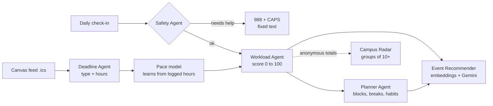

# BeachWell

**BeachWell helps CSULB students see how busy each week may be and plan ahead.** It uses Canvas deadlines and quick daily check-ins to estimate a workload score from 0 to 100, then labels each week Light, Moderate, Heavy, or Overload. It can also make a study plan, suggest small habits for heavy weeks, and recommend campus events that fit a student’s schedule. The Campus Stress Radar gives ASI, CAPS, and instructors an anonymous view of how groups of students are doing.

This is our CECS 458/558 term project for Fall 2026. Our team is Vo Hong Vy Le and Deborah Shaw.

## What we’re working on next

**Phase 1 is done.** We built a working prototype with all seven parts, ran our first evaluation, and finished the Phase 1 report. Since then, we added Deborah’s labels so the app can learn from them, improved the event recommendations and hour estimates, fixed safety rules after a new test revealed missed messages, and added 35 tests. We also put together a short portfolio summary with screenshots in `docs/reports/BeachWell_Portfolio_Summary.pdf`.

Here’s what we still need to do, in order of due date. The task owners are suggestions, so we can adjust them as we agree.

### By Fri Oct 23: data

- [ ] **Add real event dates** (Deborah, overdue): Replace the placeholder dates and times in `backend/data/events_catalog.csv` with real ASI, CAPS, and Rec programs. Then run `python scripts/seed.py --reset`. The tracker at `docs/BeachWell_Event_Updates.xlsx` has one row per current program, 30 more programs to look up, and links to official pages.
- [x] **Add Deborah’s labels** (done Oct 27): `effort_labels_deborah.csv`, `persona_labels_deborah.csv`, and 30 safety messages in `safety_messages_team.csv`. We’ve already used them; see “Learning from the team’s labels” below.
- [ ] **Add Vy’s labels** (Vy): Fill in `effort_labels_vy.csv` and `persona_labels_vy.csv` without looking at Deborah’s sheets. This should take about two hours. Then we can measure agreement with Cohen’s kappa and average the labels.
- [ ] **Write Vy’s unseen safety set** (Vy): Add 15 everyday-stress messages and 15 help-needed messages to `backend/labeling/safety_messages_unseen.csv`, without looking at `agents/safety.py` or Deborah’s set. We used Deborah’s set to improve the rules, so Vy’s set will give us a fair test.
- [ ] **Re-learn and re-test** (Vy): Run `python scripts/merge_labels.py`, then `python scripts/learn_from_labels.py`, then `python eval/evaluate.py`.

### By Fri Oct 30: run with Gemini

- [ ] Get a Gemini API key from Google AI Studio and put it only in `backend/.env`. Don’t commit it.
- [ ] **Re-run the evaluation** (Vy): Run `python eval/evaluate.py` to compare Gemini results with the offline and baseline results.
- [ ] **Review Gemini’s mistakes** (Vy): Check `GET /api/llm-log` and note its response time, any failures, and the hour estimates it got most wrong.

### By Fri Nov 13: finish the app on GitHub

- [ ] **Set up the GitHub repo** (both): We’ll each commit our own work. Vy is handling the backend, AI agents, and evaluation; Deborah is handling the web app, event list, and docs. Before committing, check that there are no API keys or personal data in the repo.
- [ ] **Test with a real Canvas feed** (both): Import our own `.ics` files locally to make sure the reader works. Don’t upload them anywhere.
- [ ] **Polish the web app** (Deborah): Check the phone layout and wording on every screen. The page background is now light grey-blue (`#F3F7F8`), set in `frontend/styles.css`.

### By Fri Nov 20: Phase 2

- [ ] **Write the 2-page progress report** (Deborah writes; Vy adds the numbers): Cover what we built, our evaluation with the team’s labels and Gemini, and what changed since Phase 1.
- [ ] **Finish the GitHub documentation**: Update this README, `docs/AI_WORKFLOW.md` (prompts, inputs, outputs, and limitations), and the instructions for reproducing our results.

### By Fri Dec 4: classmate test and error review

- [ ] **Run the usability test** (Deborah leads): Test with 8–10 classmates using `usability/test_script.md`. Enter their answers in `usability/sus_responses.csv`, then run `python scripts/score_sus.py`.
- [ ] **Review errors** (Vy): Look at the biggest misses, such as inaccurate hour estimates or poor event recommendations, and write them up for the final report.

### By Fri Dec 11: Phase 3

- [ ] **Record a 10-minute pitch video** (both; we’ll each present our own part). One good demo moment is moving the what-if slider and watching an overload week’s score drop. Keep API keys and real student data off screen.
- [ ] **Finish the final report** (both).

We should both be ready to explain the whole system, since either of us might get questions about any part.

> BeachWell makes plans and recommendations. It doesn’t diagnose or give medical advice. If a check-in suggests someone may be in crisis, the app directs them to the 988 Lifeline and CSULB CAPS.


## What BeachWell does

| Screen | What the student sees | What powers it |
| --- | --- | --- |
| Workload | This week’s score (0–100), its level and reasons, plus a 7-week chart. The level always matches the displayed score. | Deadline Agent estimates effort; Workload Agent calculates the score |
| What-if slider | Move an assignment earlier or choose “follow my plan” to see how the scores change. A dashed mark shows each week’s original score. | Workload Agent recalculates with the new inputs |
| Plan | Study blocks of 90 minutes or less, with breaks, before-and-after workload levels, habit tips, and `.ics` export. | Planner Agent schedules study time and suggests habits |
| Recharge | Two or three de-stress events for each heavy week, picked to fit the student’s free time and interests. Picks vary by week and include a reason written in the student’s own words. | Event Recommender uses embeddings, learned event profiles, rules, and Gemini re-ranking |
| Check-in | A quick check-in about sleep and stress. It takes about 20 seconds; the note is checked for safety, then discarded. | Safety Agent |
| My pace | For example: “You take 30% longer than estimated on essays.” Students can log hours and adjust estimates. | Personal pace model learns from logged hours |
| Campus Radar | A heatmap by college and week, overload alerts, and deadline collisions with a what-if option. | Radar Agent aggregates anonymous data and only shows groups of 10 or more |

## Quick start (about 5 minutes)

You’ll need Python 3.10 or newer. You don’t need a database server or Node.js.

```bash
cd backend
python -m venv .venv
# Windows: .venv\\Scripts\\activate      macOS/Linux: source .venv/bin/activate
pip install -r requirements.txt
cp .env.example .env              # Windows: copy .env.example .env
python scripts/seed.py --reset    # sample events, a synthetic cohort, and the demo student "Vy"
uvicorn beachwell.app:app --reload --port 8000
```

Open **http://localhost:8000** and click **Open the demo**. You can see the API list at http://localhost:8000/api.

### Turn on Gemini

BeachWell works without an API key using rules and hashed embeddings. That’s called **offline mode**, and it lets anyone reproduce our results. To use Gemini, get a key from [Google AI Studio](https://aistudio.google.com) and add it to `backend/.env`:

```
GEMINI_API_KEY=your-key
LLM_MODEL=gemini-2.5-flash
EMBEDDING_MODEL=gemini-embedding-001
```

Restart the server. The app footer shows which mode is running. To use Gemini for the demo student’s deadline estimates too, reseed with `python scripts/seed.py --reset --llm`. Check [Google’s model list](https://ai.google.dev/gemini-api/docs/models) if a model name has been retired.

### Try your own Canvas deadlines

In Canvas, open **Calendar**, choose **Calendar Feed**, and copy the link. Paste it into the BeachWell welcome screen, or download the `.ics` file and upload it. BeachWell uses the link once to import deadlines and doesn’t store it. Only `https://…instructure.com` links are accepted.

### Reproduce a sample result

```bash
cd backend
python -m unittest -v           # 35 tests, offline
python eval/evaluate.py         # writes eval/results.md and eval/results.json
```

## Evaluation

These results are from offline mode and are in `backend/eval/results.md`.

| Component | Baseline | BeachWell |
| --- | --- | --- |
| Effort estimates, mean absolute error (60 items labeled by Deborah) | 2.99 h (type keyword only); 2.63 h (Phase 1 rules) | **1.92 h** with calibration learned from labels (leave-one-out) |
| Finding crunch weeks, F1 (40 synthetic semesters) | 0.67 (deadline count) | **1.00** |
| Pace learning, error in weeks 9–17 (40 simulated students) | 1.28 h (no pace) | **0.68 h** |
| Planner, average peak week (20 synthetic students) | 36.0 h | **27.4 h**, with 0 rule violations |
| Planner, overload weeks per student | 2.65 | **1.05** |
| Event picks for 24 sample students (Deborah’s picks), all 20 programs | Keyword overlap: Precision@3 0.39, Hit@1 0.58. Phase 1 BeachWell: 0.44, 0.71 | **0.54, Hit@1 0.88, MRR 0.93** with learned profiles (leave-one-out) |
| Safety screen, Deborah’s 15 help-needed messages (first, unseen run) | – | Phase 1 rules caught **6/15**; after we added general patterns, they caught 15/15. This set is now for development. |

Three of the six tests use synthetic data, and the labels we have so far came from one person, Deborah. See `eval/results.md` for details. Vy still needs to write the unseen safety test set. We can run the evaluation with a Gemini key to add Gemini’s results.

### Learning from the team’s labels (Oct 2026)

We wrote `scripts/learn_from_labels.py` to turn our labeling sheets into two small files that BeachWell uses:

- **Event profiles** (`backend/data/event_profiles.json`): For each program, these capture what sample students who picked it wrote, with more weight given to higher-ranked picks. When a new student describes what they need, BeachWell compares their words with these profiles and the event descriptions. For example, “I really need sleep” can point to the Rest and Recharge Room. We also fixed two issues we found while reviewing misses: the generic phrase “relax, stress relief” was being added to every search and pushing the same stress workshop into almost everyone’s top three, so we removed it. We also updated the offline tokenizer so “painting,” “stretching,” and “hiking” match “paint,” “stretch,” and “hike.”
- **Effort calibration** (`backend/data/effort_calibration.json`): A multiplier for each assignment type moves the rule-based hour estimate closer to the labels. If there are only a few examples for a type, its multiplier is pulled toward the overall ratio.

For every result that uses learned information, we used leave-one-out evaluation. That means a sample student or assignment isn’t scored using information learned from that same example.

## Screenshots

| | |
| --- | --- |
|  |  |
|  |  |

## Architecture



- **Backend:** Python, [Starlette](https://www.starlette.io) (the framework FastAPI is built on), Uvicorn, and SQLite from the standard library. Each agent is a separate module in `backend/beachwell/agents/`, with its own tests.
- **AI:** Google Gemini through its REST API (`beachwell/llm.py`), with offline fallbacks. Our prompts, inputs, outputs, and the parts we built beyond the API are documented in [docs/AI_WORKFLOW.md](docs/AI_WORKFLOW.md).
- **Frontend:** One static page in `frontend/`, built with HTML, CSS, and JavaScript modules. There’s no build step; the backend serves it.

## Project layout

```text
backend/
  beachwell/
    app.py            HTTP API and static file serving
    service.py        glue between storage and agents
    config.py         settings from environment variables / .env
    db.py             SQLite schema (feed links never stored; check-in notes discarded)
    ical.py           read Canvas .ics feeds, write .ics study plans
    llm.py            Gemini REST client, call log, offline fallbacks
    semester.py       week-of-term helpers
    seed.py           loads the event catalog; builds the synthetic cohort and demo student
    agents/
      deadline.py     Deadline Agent: type and hour estimates
      pace.py         personal pace model (empirical Bayes)
      forecast.py     Workload Agent: weekly load index and reasons
      planner.py      Planner Agent: scheduler, rule checker, habits
      events.py       Event Recommender: retrieval, time fit, re-ranking
      safety.py       Safety Agent: rules + Gemini, fixed crisis response
      radar.py        Campus Radar: anonymous heatmap, alerts, collisions
  data/               events_catalog.csv (editable), sample Canvas feeds (.ics),
                      event_profiles.json and effort_calibration.json (learned from labels)
  scripts/
    seed.py                     create the database
    make_practice_semesters.py  regenerate the 40 practice semesters
    merge_labels.py             combine Vy's and Deborah's labels, measure agreement
    learn_from_labels.py        learn event profiles and effort calibration from the labels
    score_sus.py                score the classmate survey
  labeling/           blank labeling sheets for each team member, plus a how-to
  tests/              unit and integration tests (python -m unittest)
  eval/               evaluation data, script and results
usability/            classmate test script, survey questions, response sheet
frontend/             index.html, styles.css, app.js
docs/AI_WORKFLOW.md   prompts, inputs/outputs, limitations, team contribution
```

## Main API endpoints

| Method | Path | Purpose |
| --- | --- | --- |
| POST | `/api/users` | Create a student |
| POST | `/api/users/{id}/calendar` | Import a Canvas feed (`{url}` or `{ics}`) |
| PUT | `/api/users/{id}/classes` | Set weekly class times |
| GET, POST | `/api/users/{id}/forecast` | Get workload scores; POST supports what-if options (`extra_lead`, `use_plan`) |
| GET | `/api/users/{id}/plan`, `/plan.ics` | Get the study plan or download it as a calendar file |
| GET | `/api/users/{id}/events` | Get de-stress picks for heavy weeks |
| POST | `/api/users/{id}/checkins` | Submit a check-in with safety screening |
| GET | `/api/users/{id}/pace` | Get the personal pace model |
| PATCH | `/api/users/{id}/tasks/{task_id}` | Log actual hours, correct an estimate, or mark a task done |
| GET | `/api/radar` | Get the Campus Stress Radar |
| GET | `/api/llm-log` | See recent Gemini calls, response times, and success status |

## Data

BeachWell doesn’t need real student data. The files below are generated by our code, copied from public CSULB pages, or written by our team.

| File | What it is | Where it comes from |
| --- | --- | --- |
| `backend/data/events_catalog.csv` | 20 recurring campus programs, including titles, locations, days, times, and tags | Public ASI, CAPS, and recreation pages; clubs marked “sample” are invented. Edit the list, then run `python scripts/seed.py --reset`. |
| `backend/data/sample_canvas_feed.ics` | A Canvas-style calendar for 5 courses and 89 deadlines | Generated for testing; upload it on the welcome screen to try the import |
| `backend/data/sample_canvas_feed_business.ics` | Another sample calendar with 4 business and GE courses | Generated |
| `backend/eval/data/practice_semesters.json` and `_deadlines.csv` | 40 practice semesters, each with one known crunch week and one decoy week | Generated by `scripts/make_practice_semesters.py` |
| `backend/eval/data/effort_labels.csv` | 60 assignment titles with type and estimated hours | Written by `merge_labels.py` from our labeling sheets. For now, it only includes Deborah’s labels; the prototype’s draft labels are in `eval/data/draft/`. |
| `backend/eval/data/event_personas.json` | 24 sample students and the events that fit them best | Created from the same labeling process |
| `backend/data/event_profiles.json`, `backend/data/effort_calibration.json` | What BeachWell learned from the labels | Generated by `scripts/learn_from_labels.py` |
| `backend/labeling/safety_messages_team.csv` | Deborah’s 15 everyday-stress and 15 help-needed messages | Written by our team and used to improve the safety rules; this is the development set |
| `backend/labeling/safety_messages_unseen.csv` | Vy’s 30 messages for an unseen safety test | To be written without looking at the rules |
| `backend/eval/data/safety_messages.csv` | 30 everyday-stress and 30 help-needed messages | Written for the prototype |
| `backend/labeling/` | Blank sheets for Vy and Deborah, the event list, and a new safety set to write | Our team’s work; see `labeling/README.md` (about two hours each) |
| `usability/` | Test script, SUS survey, and response sheet for 8–10 classmates | Our team’s work; see `usability/test_script.md` |

### Team workflow for the data

1. Each of us fills in our own sheets in `backend/labeling/` without looking at the other person’s.
2. Deborah’s 30 safety messages are in `safety_messages_team.csv` and are now used for development. Vy will write 30 more in `safety_messages_unseen.csv` without looking at the rules.
3. Run `python scripts/merge_labels.py`, then `python scripts/learn_from_labels.py`, then `python eval/evaluate.py`.
4. Run the classmate test, add the answers to `usability/sus_responses.csv`, then run `python scripts/score_sus.py`.
5. Use `labeling/agreement_report.md`, `eval/results.md`, and `usability/sus_results.md` in the reports.

## Data, privacy, and responsible AI

- All prototype data is **sample or synthetic**. The event organizers and locations are real CSULB programs, but the dates and times are placeholders.
- Canvas feed links are used once to import deadlines and are never stored. Check-in notes are screened for safety and then discarded; only the two numbers are kept.
- Students can ask to have their data deleted with one request (`DELETE /api/users/{id}`).
- The Campus Radar includes only students who opt in and never displays a group smaller than 10.
- The crisis response is fixed text written by people. The language model doesn’t generate it.
- Workload scores are estimates and are labeled as such. Students can correct effort estimates.

## Known limitations

- Gemini support is implemented and tested with mocked responses, but the published numbers are from offline mode. Run `python eval/evaluate.py` with a key to measure the Gemini versions.
- Some evaluation labels are still placeholders and need to be reviewed by two team members.
- The semester calendar, including the start date and Thanksgiving week, is a placeholder. Set it in `.env`.
- SQLite works for a prototype. A campus version would need PostgreSQL and CSULB SSO sign-in.
- The “expected events” projection assumes recurring programs happen in the same week of the term each time.

## Team contributions

| Member | Responsibility |
| --- | --- |
| Vo Hong Vy Le | Backend, AI agents, and evaluation |
| Deborah Shaw | Web app, market research, event catalog, and reports |
| Both | Independent labeling of the test data |

License: MIT.
