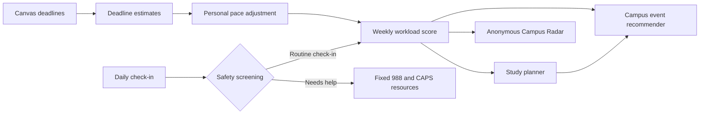

# BeachWell

**A smarter way for CSULB students to plan busy weeks.**

*CECS 458/558 · Fall 2026 · Team project by Vo Hong Vy Le and Deborah Shaw*

We built BeachWell because college deadlines tend to pile up all at once. A calendar tells us *when* assignments are due, but not how stressful a week might be or how to spread the work out. BeachWell takes Canvas deadlines and quick daily check-ins, estimates a weekly workload score, and helps students make a more manageable plan. It also suggests campus activities that fit their schedules.

Our goal isn't to tell students how they feel. It's to give them a clearer picture of what's coming up and a few practical ways to prepare.


## What we built

| Feature | What it does |
| --- | --- |
| **Weekly workload** | Scores each week from 0–100 (Light, Moderate, Heavy, or Overload) and explains why. |
| **What-if planning** | Shows how starting earlier or following the suggested plan could change future workload. |
| **Study planner** | Breaks assignments into study blocks of up to 90 minutes, adds breaks and habit tips, and exports a calendar file. |
| **Recharge recommendations** | Suggests 2–3 campus activities during heavy weeks based on free time and interests, with locations, maps, and walking directions. |
| **Daily check-ins** | Lets students record sleep and stress; written notes are safety-screened and discarded. |
| **My pace** | Adjusts future hour estimates based on how long a student actually spends on different tasks. |
| **Campus Stress Radar** | Shows anonymous, aggregated workload patterns so campus staff can see when groups may be heading into a difficult week. |

### Screenshots

| Planning ahead | Building a study plan |
| --- | --- |
|  |  |
| **Finding time to recharge** | **Campus-wide workload patterns** |
|  |  |

## Run it locally

You'll need **Python 3.10+**. There's no Node.js build step or separate database server.

From the project root:

```bash
cd backend
python -m venv .venv
source .venv/bin/activate   # Windows: .venv\Scripts\activate
pip install -r requirements.txt
cp .env.example .env        # Windows: copy .env.example .env
python scripts/seed.py --reset
uvicorn beachwell.app:app --reload --port 8000
```

Visit **http://localhost:8000** and choose **Open the demo**. The seed script creates sample events, a synthetic group of students, and a demo student. API routes are listed at `http://localhost:8000/api`.

### Try it with Canvas

In Canvas, go to **Calendar → Calendar Feed**. You can paste the feed URL on BeachWell's welcome screen or download and upload the `.ics` file. The app uses the link to import deadlines without storing it. Only `https://…instructure.com` feed URLs are accepted.

### Optional: use Gemini

We designed the prototype to work **without an API key** using rules and offline text matching. If you want to try the Gemini-powered features, get a key from [Google AI Studio](https://aistudio.google.com) and add these values to `backend/.env`:

```dotenv
GEMINI_API_KEY=your-key
LLM_MODEL=gemini-2.5-flash
EMBEDDING_MODEL=gemini-embedding-001
```

Restart the server. To rebuild the demo deadlines using Gemini estimates, run `python scripts/seed.py --reset --llm` from `backend/`. Model availability may change; see [Google's model documentation](https://ai.google.dev/gemini-api/docs/models). **Never commit `.env` or an API key.**

## How it works

We split the logic into smaller agents so we could test and improve each part separately.



The **backend** uses Python, Starlette, Uvicorn, and SQLite. The **frontend** is plain HTML, CSS, and JavaScript. We integrated Gemini through a REST client, but kept deterministic offline fallbacks so the project can still be run and evaluated without paid services. More details about the prompts and agent boundaries are in [`docs/AI_WORKFLOW.md`](docs/AI_WORKFLOW.md).

Two parts improved after we reviewed our early results:

- **Effort estimates:** We used labeled assignments to calibrate the hours predicted by our original rules. The calibration adjusts estimates by assignment type and avoids overreacting when we have only a few examples.
- **Event recommendations:** We learned event profiles from sample students' ranked choices. We also fixed overly generic search terms and word matching that had caused repetitive or irrelevant recommendations.

For the learned components, our reported evaluation uses leave-one-out testing so an example isn't evaluated using a profile learned from itself.

## What we tested

We compared BeachWell against simpler baselines in offline mode. These are **prototype results**, not results from a campus deployment.

| Test | Baseline | BeachWell |
| --- | --- | --- |
| Assignment effort, mean absolute error (60 labeled items) | 2.99 h (keywords); 2.63 h (earlier rules) | **1.92 h** with learned calibration |
| Detecting crunch weeks, F1 (40 synthetic semesters) | 0.67 | **1.00** |
| Personal pace prediction error, weeks 9–17 (40 simulated students) | 1.28 h | **0.68 h** |
| Average peak workload (20 synthetic students) | 36.0 h | **27.4 h**, with no planner rule violations |
| Average overload weeks per student | 2.65 | **1.05** |
| Event recommendations, Precision@3 (24 sample students) | 0.38 keyword baseline | **0.54** with learned profiles; Hit@1 **0.88**, MRR **0.93** |
| Safety screening, 15 help-needed examples | Earlier rules caught 6/15 | Revised rules caught 15/15 on the same set, which is now development data |

Some tests use synthetic data, and the labeled evaluation currently reflects one team member's labels. We still need a second independent labeling set, a truly unseen safety test, and results from running Gemini rather than mocked responses. See [`backend/eval/results.md`](backend/eval/results.md) for the evaluation details.

To run the tests and regenerate results:

```bash
cd backend
python -m unittest -v       # 37 offline tests
python eval/evaluate.py     # writes eval/results.md and eval/results.json
```

## Campus events and maps

We started with a catalog of **50 programs**. After checking official campus sources, **24 real programs** were confirmed to run this term, along with **6 clearly labeled sample clubs**. The other 20 programs were marked not running and are excluded from suggestions. Real recommended programs have confirmed days and times, and the app shows building information, a map, and walking directions through Google Maps without requiring a Maps API key.

The event data comes from `docs/BeachWell_Event_Updates.xlsx` and is imported into `backend/data/events_catalog.csv`. Building names and map search text are kept in `backend/data/campus_locations.csv`.

To refresh the catalog after updating the spreadsheet:

```bash
cd backend
python scripts/import_event_sheet.py ../docs/BeachWell_Event_Updates.xlsx
python scripts/seed.py --reset
```

## Privacy and responsible AI

We built the demo around **sample and synthetic student data**, rather than collecting real student records for our tests. Canvas feed links are not saved, and free-text check-in notes are screened and then discarded. Students can request deletion of their stored data.

The Campus Radar only uses opt-in data and suppresses groups smaller than **10**. For check-ins that may indicate a crisis, BeachWell displays fixed human-written information about **988** and **CSULB CAPS**; Gemini does not generate the crisis response. The app provides planning support, **not a diagnosis or medical advice**. Students can correct the workload estimates.

## What we're still working on

This is a course prototype, and there are a few important things we haven't finished:

- Collect event labels, measure agreement, and rerun evaluation.
- Test safety screening on a new unseen set instead of the examples used to improve the rules.
- Run and review real Gemini evaluations, including latency and estimation mistakes.
- Check the Canvas import with a real feed locally and polish the mobile interface.
- Run a usability study with classmates and review the cases where the app performs poorly.

The semester dates still need to be configured for a real term. SQLite is appropriate for our prototype; a production campus system would need stronger deployment infrastructure and CSULB sign-in. Recurring-event projections are also estimates, not confirmed future schedules.

## Our team

| Team member | Main contributions |
| --- | --- |
| **Vo Hong Vy Le** | Backend development, AI agents, and evaluation |
| **Deborah Shaw** | Frontend development, market data research, campus event catalog, and reports |
| **Both** | Independent labeling and project testing |

**License:** MIT