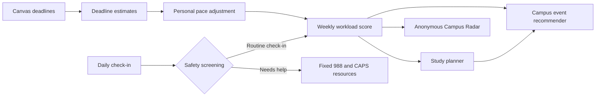

# BeachWell

**A workload planner for CSULB students.**

*CECS 458/558 · Fall 2026 · Team project by Vo Hong Vy Le and Deborah Shaw*

For our CECS 458/558 project, we wanted to work on something we could actually see students using. We've both had weeks when several assignments were due around the same time, and just seeing everything on a calendar didn't really help us figure out where to start.

That's why we made BeachWell. Students can bring in their Canvas deadlines, see which weeks might get busy, and get a study plan that spreads the work out. We also added short daily check-ins and campus event suggestions, because managing a busy semester isn't only about finishing assignments.

It's still a class project, so we're testing what works and what needs improvement.


## What you can do with BeachWell

| Feature | What it does |
| --- | --- |
| **Weekly workload** | Scores each week from 0–100 (Light, Moderate, Heavy, or Overload) and explains why. |
| **What-if planning** | Shows how starting earlier or following the suggested plan could change future workload. |
| **Study planner** | Breaks assignments into study blocks of up to 90 minutes, adds breaks and habit tips, and exports a calendar file. |
| **Recharge recommendations** | Suggests 2–3 campus activities during heavy weeks based on free time and interests, with locations, maps, and walking directions. |
| **Daily check-ins** | Lets students record sleep and stress; written notes are safety-screened and discarded. |
| **My pace** | Adjusts future hour estimates based on how long a student actually spends on different tasks. |
| **Campus Stress Radar** | Shows anonymous, aggregated workload patterns so campus staff can see when groups may be heading into a difficult week. |

### Screenshots

| Planning ahead | Building a study plan |
| --- | --- |
|  |  |
| **Finding time to recharge** | **Campus-wide workload patterns** |
|  |  |

## Run it locally

You'll need **Python 3.10+**. There's no Node.js build step or separate database server.

From the project root:

```bash
cd backend
python -m venv .venv
source .venv/bin/activate   # Windows: .venv\Scripts\activate
pip install -r requirements.txt
cp .env.example .env        # Windows: copy .env.example .env
python scripts/seed.py --reset
uvicorn beachwell.app:app --reload --port 8000
```

Visit **http://localhost:8000** and choose **Open the demo**. The seed script creates sample events, a synthetic group of students, and a demo student. API routes are listed at `http://localhost:8000/api`.

### Try it with Canvas

In Canvas, go to **Calendar → Calendar Feed**. You can paste the feed URL on BeachWell's welcome screen or download and upload the `.ics` file. The app uses the link to import deadlines without storing it. Only `https://…instructure.com` feed URLs are accepted.

### Optional: use Gemini

The app also works **without an API key** using rules and offline text matching. If you want to try the Gemini-powered features, get a key from [Google AI Studio](https://aistudio.google.com) and add these values to `backend/.env`:

```dotenv
GEMINI_API_KEY=your-key
LLM_MODEL=gemini-2.5-flash
EMBEDDING_MODEL=gemini-embedding-001
```

Restart the server. To rebuild the demo deadlines using Gemini estimates, run `python scripts/seed.py --reset --llm` from `backend/`. Model availability may change; see [Google's model documentation](https://ai.google.dev/gemini-api/docs/models). Keep `.env` and API keys out of GitHub.

## How it works

We used separate modules for the different parts of the app. This made it easier for us to test one feature at a time instead of trying to debug everything together.



The **backend** uses Python, Starlette, Uvicorn, and SQLite. The **frontend** is plain HTML, CSS, and JavaScript. We integrated Gemini through a REST client, but kept deterministic offline fallbacks so the project can still be run and evaluated without paid services. More details about the prompts and agent boundaries are in [`docs/AI_WORKFLOW.md`](docs/AI_WORKFLOW.md).

A couple of things changed quite a bit once we started looking at the test results:

- **Assignment time estimates:** Our first version relied on rules, but the predicted hours were often off. We used labeled assignments to adjust those estimates by assignment type, while being careful with categories that had only a few examples.
- **Event suggestions:** At first, the app kept recommending some of the same activities. We used sample students' ranked choices to improve the matches, then fixed some search terms and word matching that were causing repetitive suggestions.

For these learned parts, we used leave-one-out evaluation so we weren't testing an example against information learned from that same example.

## What we tested

We ran the offline version against a few simpler approaches to see whether our changes actually helped. These results are from our prototype tests, not from real campus use.

| Test | Baseline | BeachWell |
| --- | --- | --- |
| Assignment effort, mean absolute error (60 labeled items) | 2.99 h (keywords); 2.63 h (earlier rules) | **1.92 h** with learned calibration |
| Detecting crunch weeks, F1 (40 synthetic semesters) | 0.67 | **1.00** |
| Personal pace prediction error, weeks 9–17 (40 simulated students) | 1.28 h | **0.68 h** |
| Average peak workload (20 synthetic students) | 36.0 h | **27.4 h**, with no planner rule violations |
| Average overload weeks per student | 2.65 | **1.05** |
| Event recommendations, Precision@3 (24 sample students) | 0.38 keyword baseline | **0.54** with learned profiles; Hit@1 **0.88**, MRR **0.93** |
| Safety screening, 15 help-needed examples | Earlier rules caught 6/15 | Revised rules caught 15/15 on the same set, which is now development data |

There are limits to these numbers. Several tests use simulated students or semesters, and so far the labeling results come from Deborah's set. We still need Vy's independent labels, a new safety test set, and evaluation runs with Gemini enabled. The full results are in [`backend/eval/results.md`](backend/eval/results.md).

To run the tests and regenerate results:

```bash
cd backend
python -m unittest -v       # 37 offline tests
python eval/evaluate.py     # writes eval/results.md and eval/results.json
```

## Campus events and maps

We originally collected **50 campus programs**, but not all of them were actually running this semester. After checking the official pages, we kept **24 confirmed real programs** and **6 sample clubs** for the demo. The other 20 are marked as not running, so the app doesn't recommend them.

We also added the building and room information, a map, and walking directions. That way, a recommendation is more useful than just the name of an event. The directions open in Google Maps, without needing a Maps API key.

The event data comes from `docs/BeachWell_Event_Updates.xlsx` and is imported into `backend/data/events_catalog.csv`. Building names and map search text are kept in `backend/data/campus_locations.csv`.

To refresh the catalog after updating the spreadsheet:

```bash
cd backend
python scripts/import_event_sheet.py ../docs/BeachWell_Event_Updates.xlsx
python scripts/seed.py --reset
```

## Privacy and responsible AI

For testing, we used **sample and synthetic student data** instead of collecting actual student records. The app doesn't save Canvas feed links, and it discards written check-in notes after the safety check. Students can also delete their stored data.

The Campus Radar only uses opt-in data and suppresses groups smaller than **10**. For check-ins that may indicate a crisis, BeachWell displays fixed human-written information about **988** and **CSULB CAPS**; Gemini does not generate the crisis response. The app provides planning support, **not a diagnosis or medical advice**. Students can correct the workload estimates.

## What we're still working on

We're still working on a few things before the final course submission:

- Collect Vy's independent effort and event labels, measure agreement, and rerun evaluation.
- Test safety screening on a new unseen set instead of the examples used to improve the rules.
- Run and review real Gemini evaluations, including latency and estimation mistakes.
- Check the Canvas import with a real feed locally and polish the mobile interface.
- Run a usability study with 8–10 classmates and review the cases where the app performs poorly.

The semester dates still need to be configured for a real term. SQLite is appropriate for our prototype; a production campus system would need stronger deployment infrastructure and CSULB sign-in. Recurring-event projections are also estimates, not confirmed future schedules.

## Our team

| Team member | Main contributions |
| --- | --- |
| **Vo Hong Vy Le** | Backend development, AI agents, and evaluation |
| **Deborah Shaw** | Frontend development, market research, campus event catalog, and reports |
| **Both** | Independent labeling and project testing |

We divided up the main development work, then brought everything together into the same app.

**License:** MIT
