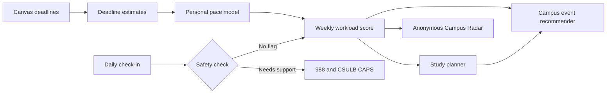

# BeachWell

**Helping CSULB students plan around busy weeks, not just react to them.**

BeachWell is our Fall 2026 CECS 458/558 team project. We wanted to build something that could look at a student's upcoming Canvas deadlines, estimate how demanding each week might be, and help them make a more manageable plan. Instead of only showing a calendar, BeachWell gives a weekly workload score, suggests when to start assignments, and recommends campus activities that fit around classes and studying.

We also built a **Campus Stress Radar** to explore how aggregated, anonymous workload trends might help campus staff spot especially busy weeks. BeachWell is a planning prototype, not a medical or mental-health diagnostic tool.

**Team:** Vo Hong Vy Le and Deborah Shaw  
**Course:** CECS 458/558 · Fall 2026


## What we built

| Feature | What it does |
| --- | --- |
| **Weekly workload** | Scores each week from 0–100 and labels it Light, Moderate, Heavy, or Overload. The dashboard also explains what is driving the score. |
| **What-if planning** | Lets students see how starting earlier or following a suggested plan could change future workload scores. |
| **Study plan** | Breaks assignments into study sessions of up to 90 minutes, adds breaks and habit suggestions, and exports a calendar `.ics` file. |
| **Recharge recommendations** | Suggests 2–3 campus events for heavier weeks based on interests and available time. |
| **Daily check-in** | Collects a quick sleep and stress check-in. Notes are checked for safety and then discarded. |
| **My pace** | Learns from the hours students log so future assignment estimates can better match their pace. |
| **Campus Stress Radar** | Shows workload patterns by college and week using opted-in, aggregated groups of at least 10 students. |

### A few screenshots

| Planning ahead | Building a study plan |
| --- | --- |
|  |  |
| **Finding time to recharge** | **Campus-wide workload trends** |
|  |  |

## How it works

We divided the app into smaller components so we could test the workload estimates, planning, event recommendations, and safety checks separately.



**Tech stack:** Python, Starlette, Uvicorn, SQLite, HTML, CSS, and JavaScript. We use Google Gemini through its REST API when configured, but we also built an offline mode using rules and hashed embeddings. The frontend is a static web app served by the Python backend, so there is no Node.js build step.

The agent modules are in `backend/beachwell/agents/`. We documented the AI prompts, inputs, outputs, and limitations in [docs/AI_WORKFLOW.md](docs/AI_WORKFLOW.md).

## Run it locally

You'll need **Python 3.10+**. No separate database server or Node.js installation is required.

From the project root:

```bash
cd backend
python -m venv .venv
source .venv/bin/activate   # Windows: .venv\Scripts\activate
pip install -r requirements.txt
cp .env.example .env        # Windows: copy .env.example .env
python scripts/seed.py --reset
uvicorn beachwell.app:app --reload --port 8000
```

Open **http://localhost:8000** and select **Open the demo**. The seed command loads sample campus events, a synthetic student cohort, and our demo student. API endpoints are listed at **http://localhost:8000/api**.

### Optional: use Gemini

The app works without an API key. If you want to try the Gemini-supported features, get a key from [Google AI Studio](https://aistudio.google.com) and add these values to `backend/.env`:

```dotenv
GEMINI_API_KEY=your-key
LLM_MODEL=gemini-2.5-flash
EMBEDDING_MODEL=gemini-embedding-001
```

Restart the server. To also generate the demo student's deadline estimates using Gemini, run this from `backend/`:

```bash
python scripts/seed.py --reset --llm
```

The app footer indicates which mode is active. Model availability can change; check [Google's model documentation](https://ai.google.dev/gemini-api/docs/models) if needed. **Never commit your `.env` file or API key.**

### Import Canvas deadlines

In Canvas, go to **Calendar → Calendar Feed**. You can paste the feed link into BeachWell's welcome screen or download and upload the `.ics` file. The app uses the link for importing and does not save it; only HTTPS Canvas feed links under `instructure.com` are accepted.

## Testing and results

We started with a working Phase 1 prototype and then used our first labeling and evaluation results to improve the estimates and recommendations. The results below are from the **offline-mode evaluation** in `backend/eval/results.md`, not a live campus deployment.

| What we measured | Earlier baseline | Current BeachWell result |
| --- | --- | --- |
| Assignment effort error (60 labeled items) | 2.99 hours, keyword baseline; 2.63 hours, Phase 1 rules | **1.92 hours** mean absolute error after calibration |
| Identifying crunch weeks (40 synthetic semesters) | 0.67 F1 | **1.00 F1** |
| Personal pace error, weeks 9–17 (40 simulated students) | 1.28 hours | **0.68 hours** |
| Average busiest week after planning (20 synthetic students) | 36.0 hours | **27.4 hours**, with no planner rule violations |
| Average overload weeks per student | 2.65 | **1.05** |
| Event recommendations (24 sample students) | 0.38 Precision@3 and 0.63 Hit@1, keyword baseline | **0.54 Precision@3**, **0.88 Hit@1**, **0.93 MRR** |
| Safety screening (15 help-needed development messages) | 6/15 caught by the initial rules | **15/15** after revising the rules on this same set |

These numbers need context: several evaluations use synthetic data, and the human labels used for the published results came from one teammate. For the learned effort and event models, we used leave-one-out evaluation so an item was not tested against a model trained on that same item. The improved safety result is **not** an independent validation, because we revised the rules after seeing the initial misses. A separate unseen safety test is still planned.

To run the tests and evaluation from `backend/`:

```bash
python -m unittest -v
python eval/evaluate.py
```

The evaluation writes `eval/results.md` and `eval/results.json`. The project had **36 offline tests** at the time of this README update.

### What we changed after testing

We used our labeled examples to improve two parts of the app:

- **Assignment time estimates:** `scripts/learn_from_labels.py` creates `data/effort_calibration.json`, which adjusts rule-based estimates by assignment type while limiting the effect of categories with very few examples.
- **Event recommendations:** The same script creates `data/event_profiles.json` from sample students' ranked event choices. We compare a student's interests with both event descriptions and learned profiles. We also fixed some word matching and removed a generic stress-relief phrase that was making the same event appear too often.

The campus event catalog currently includes **50 real programs**, with **22 schedules confirmed** against official pages. The app distinguishes checked schedules from those not yet confirmed. Sample clubs are marked separately.

## Privacy and responsible use

We built BeachWell as a student project, so we wanted the demo to be useful without pretending it was ready for real campus deployment.

- The prototype uses sample or synthetic student records, not a real campus-wide student dataset.
- Canvas feed links are used for import and are not stored.
- Free-text check-in notes are screened and discarded; only the numeric check-in values are retained.
- A student can request deletion of their data through `DELETE /api/users/{id}`.
- Campus Radar uses only opted-in data and suppresses groups smaller than 10.
- Safety responses directing students to **988** and **CSULB CAPS** use fixed, human-written text rather than model-generated advice.
- Workload and time estimates are estimates, not diagnoses or guarantees. Students can correct estimated hours.

## Limitations and next steps

This is still a course prototype. Gemini integration has been implemented and tested with mocked responses, but the published evaluation above uses offline mode. We still need independent labels from both teammates, an unseen safety test, real-feed checks performed locally, and a usability study with classmates. The semester dates also need to be configured for the actual term.

For a production version, we would need stronger deployment infrastructure, campus authentication, and further privacy and safety review. The current SQLite setup is intended for a prototype; PostgreSQL and CSULB SSO are possible future changes. Projected recurring events are estimates and may not happen on the same week each term.

### Remaining course milestones

- **November 13:** Finish GitHub setup, check the Canvas import locally, and polish the web app.
- **November 20:** Submit the Phase 2 progress report and reproducibility documentation.
- **December 4:** Run an 8–10 person classmate usability study and review difficult cases.
- **December 11:** Submit the final report and 10-minute pitch video.

The earlier internal checklist also includes verifying more event schedules, collecting Vy's independent labels and unseen safety messages, re-running evaluation, and checking Gemini's latency and mistakes. We keep the detailed workflow in our labeling sheets, scripts, and project documents rather than putting every internal task at the top of the README.

## Our contributions

| Team member | Main work |
| --- | --- |
| **Vo Hong Vy Le** | Backend, AI agents, and evaluation |
| **Deborah Shaw** | Frontend web app, market research, event catalog, and reports |
| **Both** | Independent data labeling and overall project review |

This project was developed for **CECS 458/558, Fall 2026**.

**License:** MIT.
